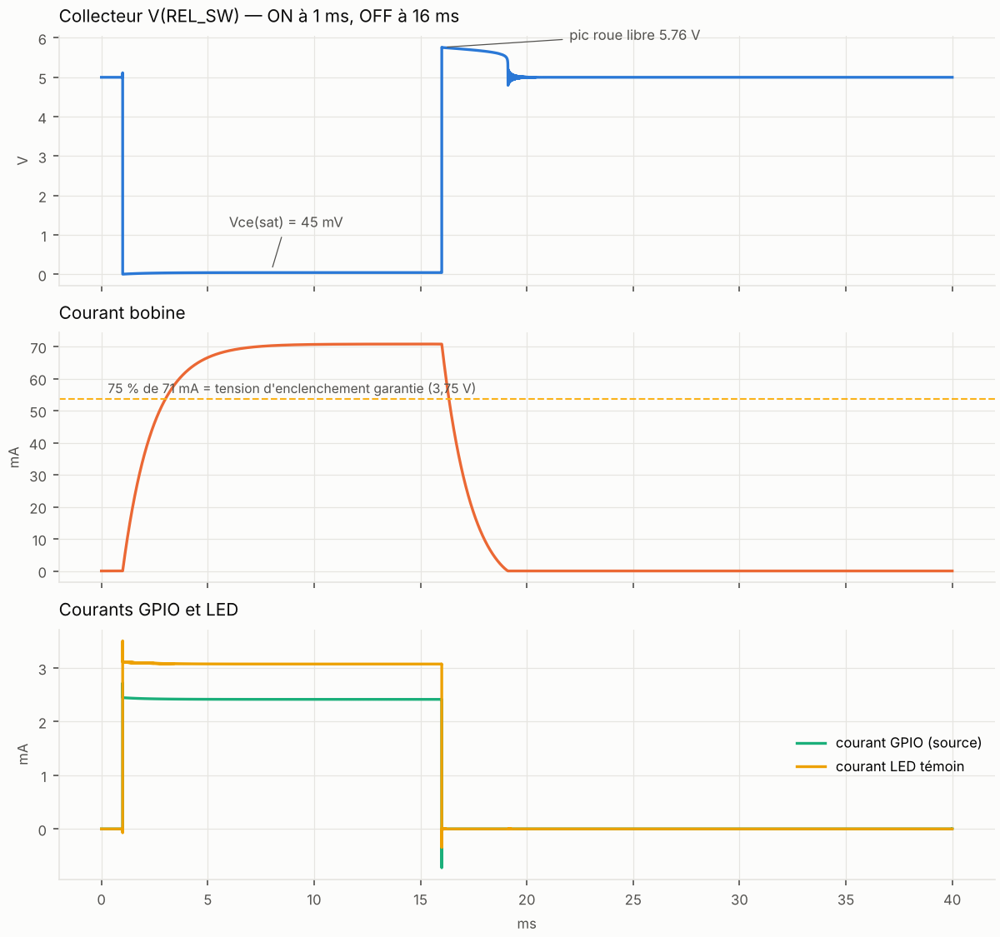
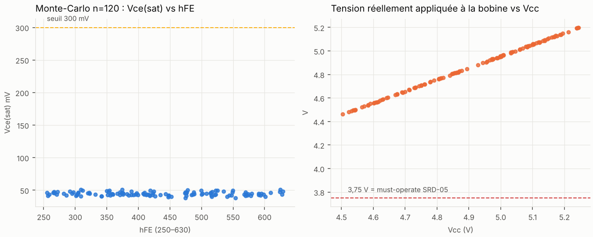
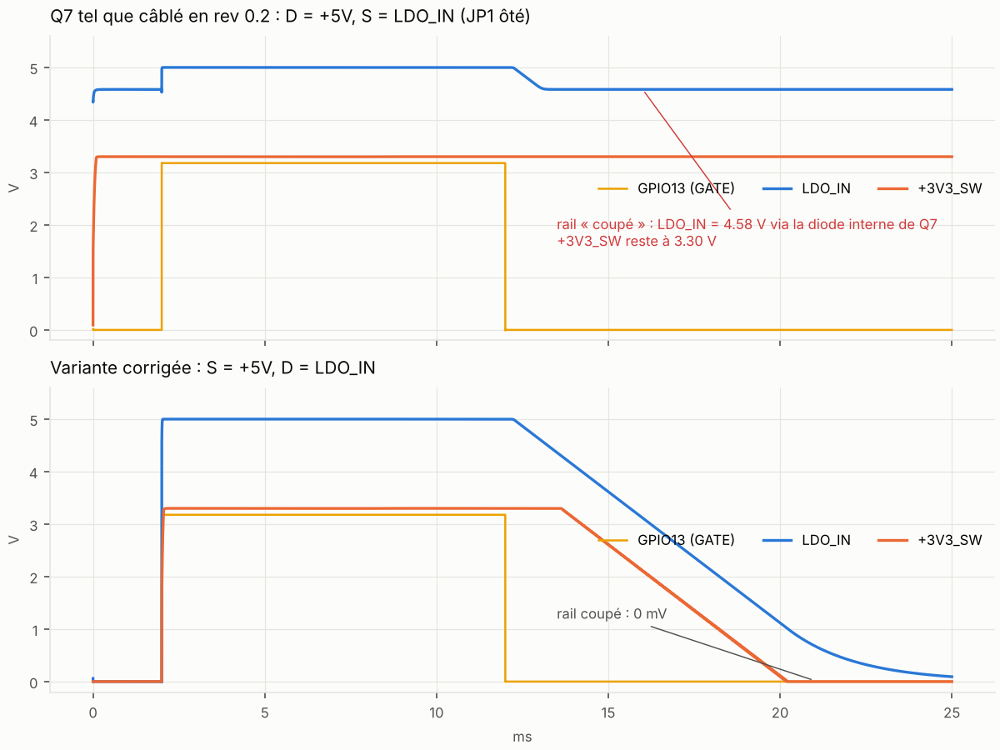
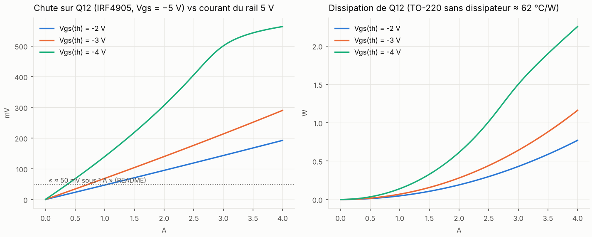
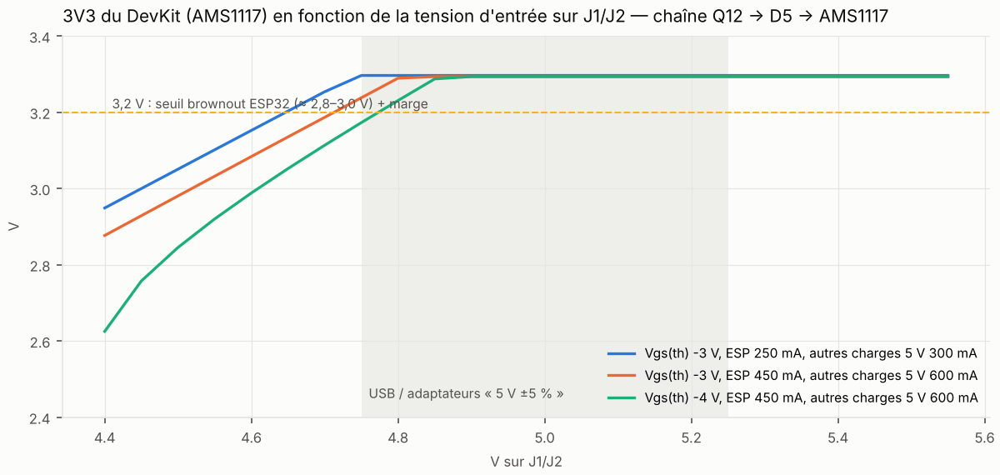
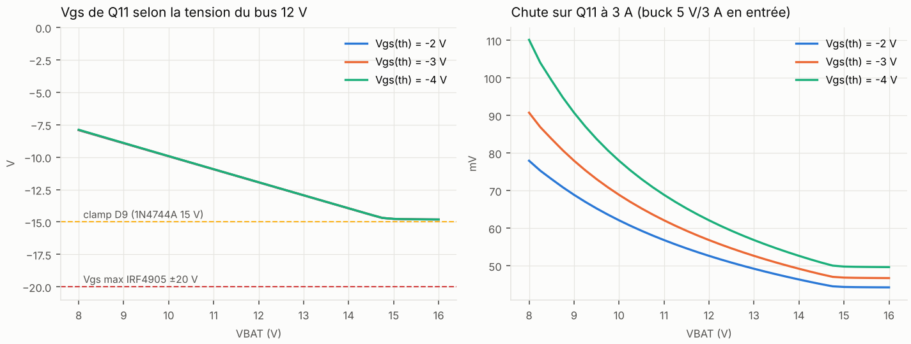
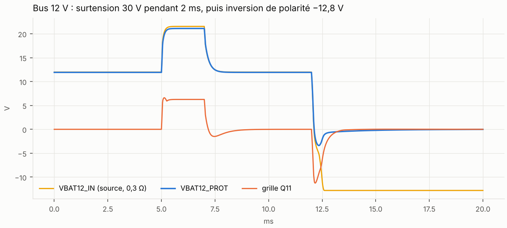
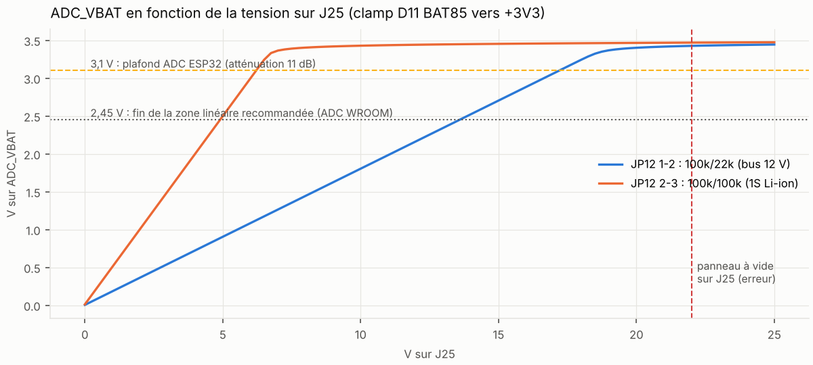
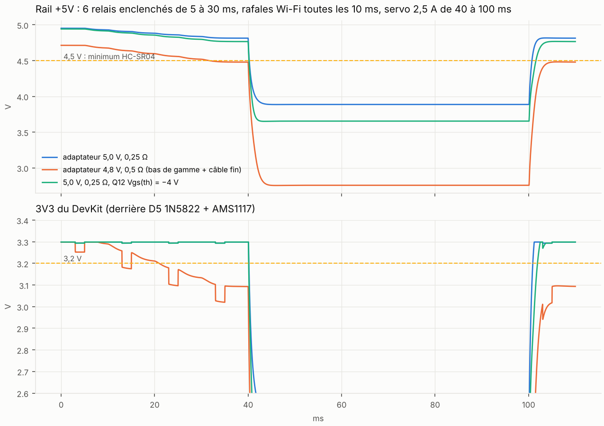

# n3-universal rev 0.2 — simulation SPICE des blocs analogiques

Instantané du **2026-10-17**, sur le schéma `kicad/n3-universal.kicad_sch` (rev 0.2 du 2026-10-07)
et la description des nets de `generator/generate.py` (`COMPONENTS`). Simulateur : **ngspice 42**
en mode batch (même moteur que le simulateur intégré de KiCad), piloté par Python
(`simulation/sim*.py`). Tout est reproductible : voir « Reproduire » en fin de document.

> **Verdict en une ligne : un défaut bloquant pour les profils msp/n3pp (Q7 câblé à l'envers,
> le rail capteurs ne se coupe jamais), deux marges serrées à documenter (budget 5 V vers le
> DevKit, pics servos), le reste tient avec de bonnes marges.** À corriger **avant** la commande
> de la rev 0.2.

> ✅ **Rev 0.2.1 (2026-10-17) — correctif appliqué** : Q7 inversé dans `generator/generate.py`
> (source = +5V, drain = LDO_IN), schéma et BOM régénérés, garde `tools/check_fet_orientation.py`
> (rôle « switch » / « reverse » par FET, vérifié dans le générateur ET dans le `.kicad_sch`),
> champs `Sim.*` portés par le générateur + `kicad/n3u_sim.lib` (le schéma s'ouvre dans le
> simulateur KiCad et s'exporte en netlist SPICE sans retouche), banc `bench_kicad_netlist.py`
> sur la netlist exportée par KiCad 8.0.9 : rail capteurs 0 V GPIO13 bas / 3,30 V GPIO13 haut.
> PCB retouché localement (pads 2/3 de Q7, pistes +5V / LDO_IN / ADC_E, README §0.2.1), zones
> remplies, **DRC KiCad 10.0.7 avec parité : 0 / 0 / 0**, gerbers v0.2.1 exportés. Les points 4, 6 et 11 (marges) sont documentés, pas modifiés.

## Synthèse

| # | Bloc | Verdict | Chiffre clé (simulation) | Action proposée |
|---|---|---|---|---|
| 1 | Étage relais K1-K6 (1k / BC337-40 / 10k / 1N4007 / LED 1k) | ✅ tient, marges larges | Vce(sat) 38-51 mV sur 120 tirages Monte-Carlo (hFE 250-630, R ±5 %, Vcc 4,5-5,25 V, −10…+60 °C) ; bobine ≥ 4,46 V (> 3,75 V requis) ; pic roue libre 5,76 V ; GPIO 2,4 mA | aucune |
| 2 | Sélecteur de forçage JP5-JP10 | ✅ | ON forcé + GPIO bas : le GPIO absorbe 0,72 mA ; OFF forcé + GPIO haut : le GPIO débite 3,1 mA | aucune |
| 3 | **Rail capteurs +3V3_SW : Q7 IRF4905** (D = +5V, S = LDO_IN) | ❌ **bloquant (msp/n3pp)** | JP1 ôté, GPIO13 bas : **LDO_IN = 4,58 V** par la diode interne de Q7, **+3V3_SW = 3,30 V** — le rail n'est jamais coupé ; résultat indépendant de Vgs(th) | **inverser D et S de Q7** (source = +5V, drain = LDO_IN) dans `generate.py` ; avec la correction le rail tombe à 0 V |
| 4 | Q12 anti-inversion 5 V (Vgs = −5 V) | ⚠️ marge selon la pièce | chute à 1 A : 47 / 69 / **140 mV** pour Vgs(th) = −2 / −3 / −4 V (dispersion datasheet) ; à 2,5 A : jusqu'à 0,41 V et 1 W | documenter la limite (≤ 2 A sur jack) ou passer à un canal P « logic-level » (Rds(on) spécifié à Vgs = −4,5 V) |
| 5 | Inversion de polarité sur J1/J2 | ✅ | courant inverse < 10 nA, +5V reste à 0 V, reprise à 4,97 V | aucune |
| 6 | **Chaîne 5 V → DevKit** (Q12 + D5 1N5822 + AMS1117) | ⚠️ marge serrée | pour 3V3 ≥ 3,2 V il faut **≥ 4,65 V** sur J1/J2 (ESP 250 mA), **≥ 4,75-4,80 V** (Wi-Fi 450 mA, Q12 défavorable) ; à 4,75 V : 3,17-3,24 V | exiger un bloc 5 V « vrai » (≥ 5,0 V en charge, câble court) ; le Hi-Link ou un buck réglé à **5,1-5,2 V** règle la question |
| 7 | Bus 12 V : Q11 + D9 zener 15 V + D8 TVS 18 V | ✅ | Vgs(Q11) borné à −14,8 V sur 10,5-15,5 V ; chute 44-73 mV à 3 A ; surtension 30 V/2 ms : bus écrêté à 21,1 V (TVS 23 A crête, ~440 W moyens) ; inversion −12,8 V : < 1 µA | aucune ; C5 25 V et bucks MP1584/XL4015 (28-38 V) tiennent 21 V |
| 8 | Pont VBAT 100k/22k (bus 12 V) | ✅ (nuance précision) | 3,1 V ADC ↔ **17,2 V** ; mais la zone linéaire de l'ADC (≤ 2,45 V) s'arrête à **13,6 V** : l'absorption AGM 14,4-14,7 V tombe dans la zone comprimée ; clamp D11 : à 22 V sur J25, ADC 3,43 V, 28 µA dans D11 — sûr ; τ = 0,53 ms | soit garder et s'appuyer sur `esp_adc_cal` (erreur typ. 1-2 % jusqu'à 3,1 V), soit 100k/18k (3,1 V ↔ 20,3 V, 14,7 V → 2,24 V) |
| 9 | Pont VBAT 100k/100k (1S) | ✅ | 4,2 V → 2,10 V ; pleine échelle 6,2 V | aucune |
| 10 | Ponts écho HC-SR04 1k/2k (JP13-15 fermés) | ✅ | écho 5,0 V → 3,23 V ; 5,25 V → 3,39 V (max abs. ESP32 3,6 V) ; front 50 ns | aucune ; JP **ouvert** avec un capteur 5 V = 5 V sur le GPIO (déjà documenté) |
| 11 | **Dynamique du rail 5 V** (6 relais + Wi-Fi + servo) | ⚠️ selon la source | relais + Wi-Fi seuls : 4,81 V (bloc 5 V/0,25 Ω) ; bloc faible 4,8 V/0,5 Ω : 4,48 V et 3V3 du DevKit à 3,02 V pendant les rafales ; **appel servo 2,5 A : +5V tombe à 3,65-3,9 V (2,75 V avec le bloc faible), 3V3 à 2,2-2,4 V → reset ESP32** quelle que soit la source simulée | ne jamais alimenter les servos par le jack 5 V/2,5 A : Hi-Link 20M05 ou buck 5 A, câble court, et/ou alimentation servo séparée (déjà envisagé pour le profil 12 V : à rendre explicite) |

Ce que les contrôles existants ne pouvaient pas voir : ERC/DRC vérifient la connectivité et la
géométrie, pas le sens de conduction d'un MOSFET. Le point 3 est précisément un cas « netlist
correcte, circuit faux ».

## 1-2. Étage relais et forçage

Circuit simulé : GPIO (3,3 V, 50 Ω de sortie) → Rb 1k → base BC337-40, Rp 10k base-GND,
bobine SRD-05 (70 Ω + L), 1N4007 en roue libre, LED rouge + 1k en parallèle de la bobine,
Rf 1k vers +3V3 (ON forcé) ou base à GND (OFF forcé).



- Point de fonctionnement nominal : Ib = 2,4 mA, Ic = 70,8 mA (bobine) + 3,1 mA (LED),
  **Vce(sat) = 45 mV**, 3,3 mW dans le transistor. Rapport Ic/Ib ≈ 30 : saturation franche
  même pour le hFE minimum.
- Coupure : pic collecteur **5,76 V** (Vcc + Vf 1N4007). Le courant de bobine s'éteint en
  1,1 / 2,2 / 4,4 ms pour L = 50 / 100 / 200 mH (l'inductance de la SRD-05 n'est pas
  documentée ; ordre de grandeur usuel 50-150 mH). C'est le retard de relâchement classique
  d'une roue libre simple — sans conséquence pour pompes, chauffage et éclairage.
- Enclenchement : 90 % du courant en 1,7-6,6 ms selon L ; la mécanique du relais (≤ 10 ms)
  domine de toute façon.



- Monte-Carlo 120 tirages (hFE uniforme 250-630, Rb/Rp ±5 %, bobine ±10 %, Vcc 4,5-5,25 V,
  GPIO 3,0-3,3 V, −10…+60 °C) : Vce(sat) 38-51 mV, tension bobine ≥ 4,46 V, 0 tirage sous
  3,75 V (must-operate), 0 tirage au-dessus de 300 mV.
- Forçage : ON forcé avec GPIO bas → le GPIO absorbe 0,72 mA (Vce(sat) 49 mV, bobine
  70,7 mA) ; OFF forcé avec GPIO haut → le GPIO débite 3,14 mA, relais ouvert. Conforme au
  commentaire de `relay_channel()`.

## 3. Rail capteurs +3V3_SW — Q7 à l'envers

Circuit simulé (JP1 **ôté**, profil msp/n3pp) : GPIO13 → R34 1k → Q8 BC337 (R48 10k) →
GATE_G, R35 100k vers +5V, Q7 IRF4905, C11 10 µF, U1 LD1117V33 (modèle comportemental),
C12 100 µF, charge 30 mA + rafale SD 150 mA.

Dans `generate.py`, Q7 est déclaré `{'1': 'GATE_G', '2': '+5V', '3': 'LDO_IN'}` avec le
brochage TO-220 1 = G, 2 = D, 3 = S : **le drain est sur +5V et la source sur LDO_IN**. Pour
un canal P, la diode interne va du drain vers la source : elle est donc **passante en
permanence de +5V vers LDO_IN**, que le canal soit commandé ou non.



- Tel que câblé, GPIO13 bas : LDO_IN = **4,58 V**, +3V3_SW = **3,30 V**, 5 mA de repos +
  la charge continuent de circuler. Le rail capteurs n'est jamais coupé ; la veille msp/n3pp
  (DS18B20, INA226, RTC, SD, OLED alimentés) ne réalise aucune économie. Résultat identique
  pour Vgs(th) = −2, −3, −4 V : ce n'est pas une question de pièce.
- GPIO13 haut : rail à 5,00 V / 3,30 V dans les deux câblages (le canal conduit dans les deux
  sens) — c'est pourquoi un test « ça marche » sur le banc ne révèle rien.
- Variante corrigée (source = +5V, drain = LDO_IN) : rail coupé à 0 V, mise en route 40 µs
  après le GPIO, extinction en ~7 ms (décharge de C12 dans la charge).
- Q11 et Q12 (anti-inversion) sont câblés drain = entrée, source = sortie, **ce qui est
  correct pour cette fonction** (la diode interne doit conduire au démarrage, puis le canal
  court-circuite la diode). Le commentaire de l'audit 0.1 (« Q11 recâblé comme Q7 ») a
  propagé la bonne orientation d'anti-inversion à un interrupteur, où elle est fausse.
- Profil ffp5cs (JP1 fermé) : aucun effet, le rail est permanent par construction.

Correctif : dans `build_components()`, Q7 → `nets={"1": "GATE_G", "2": "LDO_IN", "3": "+5V"}`
(empreinte et sérigraphie inchangées), puis régénération + DRC/parité.

## 4-6. Entrée 5 V : Q12, inversion, chaîne vers le DevKit



- L'IRF4905 n'est pas « logic-level » : Vgs(th) est spécifié −2 à −4 V, et ici Vgs ne peut
  pas dépasser −5 V (c'est la tension du rail). Chute à 1 A : 47 mV (pièce favorable),
  69 mV (typique), **140 mV** (pièce défavorable) ; à 2,5 A : 0,12 / 0,18 / **0,41 V** et
  jusqu'à 1 W dans un TO-220 nu. Le « ≈ 50 mV sous 1 A » du README n'est vrai que pour une
  pièce favorable.
- Inversion de polarité (−5 V sur J1/J2) : +5V reste à 0 V (−4 µV), courant inverse
  < 10 nA, reprise normale à 4,97 V au rebranchement correct.



- Le DevKit reçoit +5V − Vf(1N5822) et son AMS1117 (dropout 1,1 V typ., 1,3 V max à 1 A)
  doit fournir 3,3 V : pour 3V3 ≥ 3,2 V il faut ≥ 4,65 V sur J1/J2 (ESP 250 mA, Q12
  typique) et ≥ 4,75-4,80 V pendant les rafales Wi-Fi (450 mA) ou avec un Q12 défavorable.
  Un bloc USB « 5 V » tombant à 4,75 V en charge donne 3,17-3,24 V — à la limite du brownout
  (seuil ESP32 configurable 2,43-2,80 V, mais radio et SD deviennent instables bien avant).
- Conséquence pratique : la carte est faite pour un **5 V ferme** (Hi-Link 20M05, buck réglé
  5,1-5,2 V, bloc 5 V/3 A avec câble court), pas pour une alimentation USB bas de gamme. À
  écrire dans le README / TUTO.

## 7. Bus 12 V



- Vgs de Q11 suit −VBAT jusqu'au clamp de D9 : −14,8 V à 15,5 V (max IRF4905 ±20 V), courant
  zener 6,6 µA via R40. Chute à 3 A : 59-73 mV à 10,5 V, 44-50 mV à 15,5 V.



- Surtension 30 V pendant 2 ms derrière 0,3 Ω (scénario « load dump » pessimiste) :
  VBAT12_PROT écrêté à 21,1 V, 23 A crête dans D8, ~440 W moyens sur 2 ms — dans la capacité
  10/1000 µs de la 1.5KE18A (1500 W), mais sans grande réserve si l'impulsion dure plus.
- Inversion −12,8 V : < 1 µA. (Le creux à −3,4 V visible sur la courbe vient d'un
  basculement de polarité en 100 µs « à chaud », couplé par Cgd ; une inversion au
  branchement, à froid, ne produit rien.)

## 8-10. Mesures : pont VBAT, écho HC-SR04



- 100k/22k : 3,1 V ADC ↔ 17,2 V (cohérent avec le README). La zone **linéaire** recommandée
  de l'ADC WROOM (≤ 2,45 V en atténuation 11 dB) correspond à ≤ 13,6 V : l'absorption AGM
  (14,4-14,7 V) est mesurée dans la zone comprimée (14,7 V → 2,65 V). Avec `esp_adc_cal`
  (courbe de caractérisation) l'erreur reste de l'ordre de 1-2 % jusqu'à ~3,1 V ; si l'on
  veut rester en zone linéaire, 100k/18k donne 3,1 V ↔ 20,3 V et 14,7 V → 2,24 V.
- Clamp D11 : panneau à vide (22 V) sur J25 → ADC_VBAT = 3,43 V, 28 µA dans D11,
  185 µA dans R38 : sans danger pour le GPIO (max abs. 3,6 V) et pour les résistances.
- 100k/100k : 4,2 V → 2,10 V, pleine échelle 6,2 V. τ (19 kΩ × 100 nF) = 0,53 ms : attendre
  ≥ 3 ms après un changement brutal avant de lire.
- Écho HC-SR04 (sortie ~100 Ω, câble 2 m ≈ 200 pF) : 5,0 V → 3,23 V, 5,25 V → 3,39 V
  (< 3,6 V), front 50 ns. Le pont ne dégrade pas la mesure de largeur d'impulsion.

## 11. Dynamique du rail 5 V



Scénario : 6 relais enclenchés toutes les 5 ms, ESP32 80 mA + rafales Wi-Fi 350 mA (2 ms /
10 ms) derrière D5 + AMS1117, HC-SR04 ×3 + LDO capteurs 145 mA, puis **appel servo 2,5 A**
pendant 60 ms (valeur de blocage du README). Source : bloc 5 V avec 0,25 Ω + 1 µH de câble,
ou 4,8 V / 0,5 Ω ; C1 1000 µF (ESR 80 mΩ) + C2 470 µF (ESR 120 mΩ).

- Relais + Wi-Fi : 4,81 V (bloc correct) — OK. Bloc faible : 4,48 V, 3V3 du DevKit à 3,02 V
  pendant les rafales Wi-Fi → instable.
- Appel servo 2,5 A : le rail tombe à 3,65-3,89 V (2,75 V avec le bloc faible) et le 3V3 du
  DevKit à 2,2-2,4 V (1,3 V) pendant toute la durée → **reset de l'ESP32** dans les trois cas simulés. Les 1470 µF de réservoir
  ne couvrent qu'une dizaine de ms à ce courant ; c'est l'impédance de la source qui compte.
- Conclusion : les servos ne doivent pas partager un jack 5 V/2,5 A. Hi-Link 20M05 (3,6 A)
  ou buck ≥ 5 A avec câble court, ou mieux : rail servo séparé (bornier dédié, le signal
  seul passe par R20/R21).
- **Nuance par type de servo** (`sim5_servo_sweep.py`, `out/s5_servo_results.json`) : 2,5 A est le
  blocage d'un MG996R. Un SG90 bloque à ~0,65 A, un MG90S à ~1 A. Minimum du 3V3 du DevKit :
  bloc 5 V correct → 3,14 V (SG90) / 3,02 V (MG90S ou 2 SG90) / 2,84 V (1,5 A) ; bloc faible
  4,8 V/0,5 Ω → 2,63 / 2,39 / 1,96 V (brownout) ; Hi-Link ou buck 5 A à 5,1 V → 3,29 / 3,29 /
  3,28 V (OK), 3,09 V pour un MG996R. Règle : petits servos acceptés si la source est ferme
  (5,1 V, ≥ 3 A), démarrages décalés de ~100 ms dans le firmware ; MG996R jamais sur le jack.

## Limites des modèles (à lire avant de citer un chiffre)

- **IRF4905** : modèle VDMOS calibré sur la datasheet (Rds(on) 23 mΩ à −10 V, diode interne
  0,55 V à 0,5 A). La dispersion de Vgs(th) est balayée (−2/−3/−4 V), pas la température.
- **BC337-40** : modèle Gummel-Poon type NXP, hFE balayé sur 250-630 en Monte-Carlo.
- **LD1117 / AMS1117** : modèles **comportementaux** (Vout = min(3,3 ; Vin − Vdrop(I)),
  Iq 5 mA). Corrects pour DC, dropout et thermique ; **ne disent rien de la stabilité en
  fonction de l'ESR** des condensateurs de sortie (garder ≥ 10 µF électrolytique, comme prévu).
- **Bobine SRD-05** : 70 Ω connus, inductance supposée (50-200 mH balayés).
- **TVS / zener** : diodes avec Vbr et pente dynamique datasheet, coude approximatif.
- **ESP32** : source de courant (80 mA + rafales 350 mA) ; les transitoires internes au
  DevKit (AMS1117 réel, condensateurs du module) ne sont pas modélisés.
- Ni le routage (résistance des pistes, ~0,1 Ω en 2 oz sur +3V3, négligeable), ni la
  thermique réelle, ni la CEM.

## Reproduire

```bash
sudo apt install ngspice          # ngspice 42 ; python3 + numpy + matplotlib
cd hardware/n3-universal/simulation
python3 sim1_relay.py             # étage relais : transitoire, L, forçage, Monte-Carlo
python3 sim2_gate.py              # rail capteurs : câblage rev 0.2 vs corrigé, Vgs(th)
python3 sim3_power.py             # Q12, inversion, chaîne 5 V -> DevKit, Q11/D8/D9
python3 sim4_adc_rail.py          # pont VBAT, écho HC-SR04, dynamique du rail 5 V
python3 sim5_servo_sweep.py       # appel servo par type (SG90 / MG90S / MG996R) et par source

# Depuis le schéma KiCad (champs Sim.*, rev 0.2.1) : export puis banc rail capteurs
kicad-cli sch export netlist --format spice -o simulation/out/n3-universal-kicad.spice kicad/n3-universal.kicad_sch
python3 simulation/bench_kicad_netlist.py       # code 1 si le rail ne se coupe pas
```

Dans KiCad (Inspecter → Simulateur), les composants sans modèle (connecteurs, relais,
modules, fusible, varistance, points de test) sont exclus ; ajouter les sources (VDC sur
VIN_RAW, VDC ou VPULSE sur GATE/K1…) et lancer un `.op` ou un `.tran`. Attention : le lecteur
de bibliothèques SPICE de KiCad s'arrête sur un caractère non ASCII, même en commentaire —
`n3u_sim.lib` est généré translittéré depuis `models.lib` pour cette raison.

Les netlists générées (`out/*.cir`), les tracés (`out/*.png`) et les chiffres (`out/*results.json`)
sont réécrits à chaque passe. `models.lib` contient tous les modèles ; `spicelib.py` le harnais.
Chaque netlist se lance aussi seule : `ngspice -b out/s2_corrige_vto3.cir`.

## Suite proposée

1. ~~Inverser D/S de Q7, garde d'orientation~~ — **fait en 0.2.1** (générateur, schéma, BOM,
   `tools/check_fet_orientation.py`, PCB retouché, DRC 0/0/0, gerbers v0.2.1).
2. ~~Champs `Sim.*`~~ — **fait en 0.2.1** (`sim_fields()` dans `generate.py`, `kicad/n3u_sim.lib`).
3. Garder `simulation/` comme banc de non-régression : les scripts tournent en moins de deux
   minutes ; `check_fet_orientation.py` et `bench_kicad_netlist.py` ont leur place en CI à côté
   des gardes existantes.
4. Mesures banc à prévoir pour recaler les modèles : Vce(sat) réel, inductance bobine (LCR ou
   constante de temps), chute sur Q12 à 1-2 A, +5V et 3V3 à l'oscilloscope pendant un appel
   servo.
